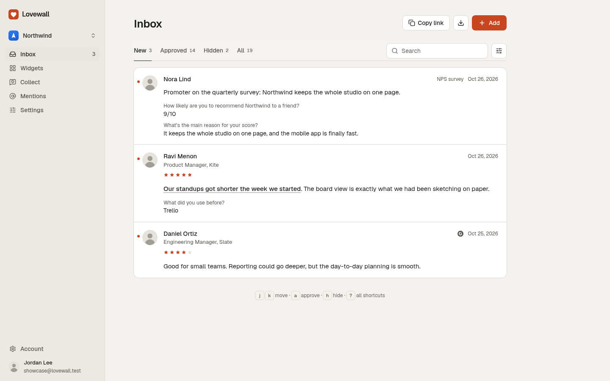
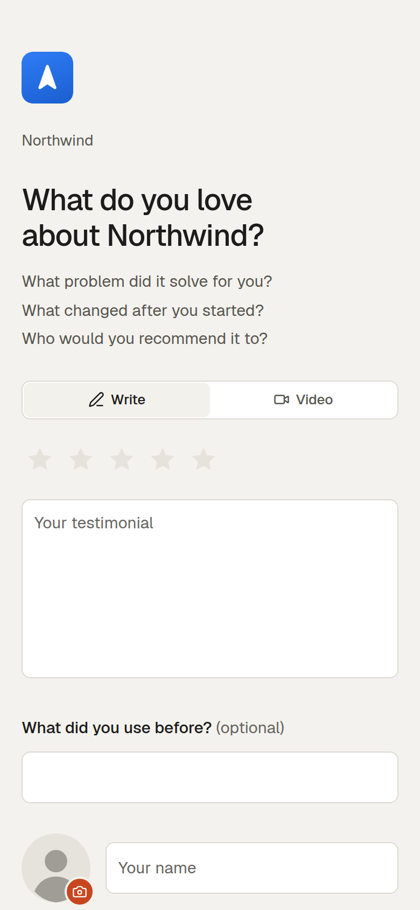
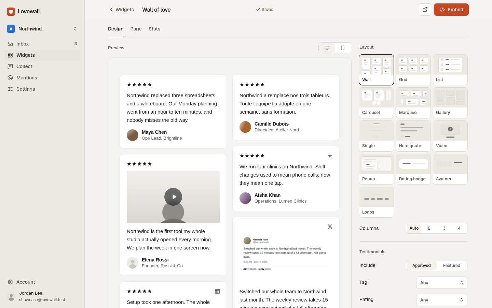
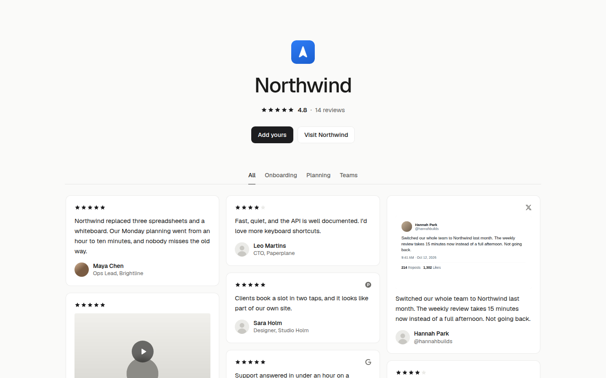
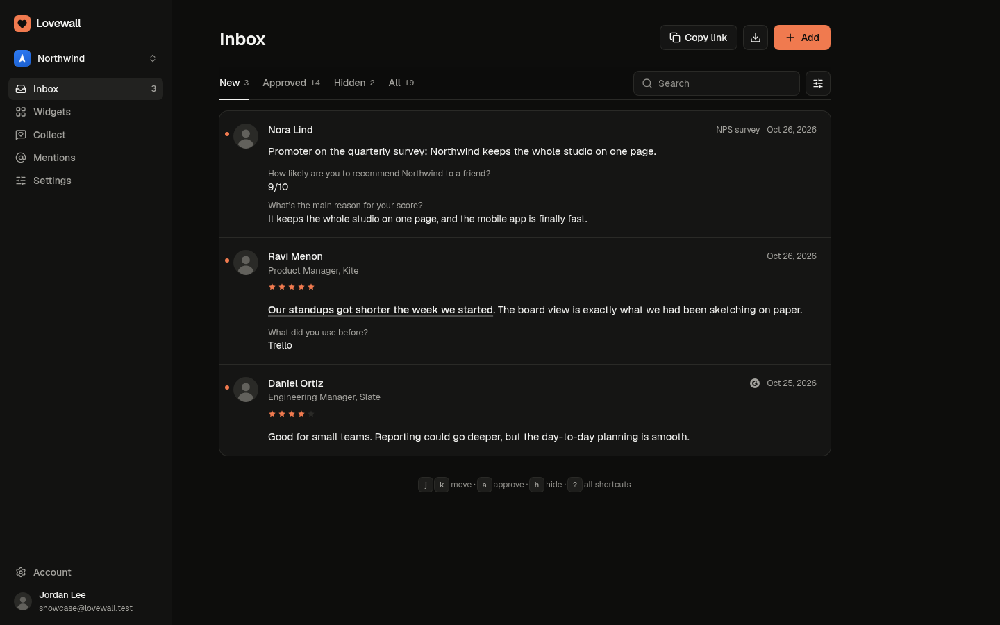

<p align="center">
  
</p>

<h1 align="center">Lovewall</h1>

<p align="center">Open-source testimonials. Collect them with one link, show them anywhere with one line.</p>

<p align="center">
  <a href="LICENSE">AGPL-3.0 license</a> ·
  <a href="#features">Features</a> ·
  <a href="#self-host">Self-host</a> ·
  <a href="#embed">Embed</a> ·
  <a href="#api-webhooks-and-integrations">API</a>
</p>

<p align="center">
  
</p>

Lovewall does what Senja and Testimonial.to do: forms, invites, imports from 20+ places, video, 13 widget layouts, a
wall of love page, analytics, an API, integrations and teams. The difference: it is open source, free to self-host with
every feature, and your data sits in your own Postgres if you want it there.

**Hosted or self-hosted.** Self-hosting is free, with every feature. If you'd rather not run a server, the hosted version
at [lovewall.tech](https://lovewall.tech) is $9 a month or $90 a year after a 14-day trial (no card). Same code, same
features: billing only switches on when `POLAR_ACCESS_TOKEN` is set, so a self-hosted install never shows a plan, a
trial or a paywall.

| Collect                                                                 | Widget configurator                                                           | Wall of love                                                              |
| ----------------------------------------------------------------------- | ----------------------------------------------------------------------------- | ------------------------------------------------------------------------- |
|  |  |  |

<p align="center"></p>

## Features

### Collect

- A collect page at `yourdomain/<space>`: star rating, text, name, title, company, photo. Video recorded in the
  browser (MP4 where supported, so it plays in Safari; up to 90 s, with retakes) or uploaded. Consent checkbox,
  thank-you screen with "Share on X" and LinkedIn.
- Several forms per space: testimonials, NPS surveys and case studies, with your own questions, on one page or step by
  step.
- Invites: paste a list or upload a CSV; each person gets their own link and one reminder; you see who opened, clicked
  and answered. One-click unsubscribe (RFC 8058).
- Rewards: a coupon code, a link, or a spin of the wheel.
- 22 languages for the collect page, or the visitor's own (from `Accept-Language`).
- Your own domain for forms and wall pages (`love.yourcompany.com`), verified by a TXT record.
- Reply to a testimonial by email from the inbox.

### Import

- From a link: Google, Trustpilot, G2, Capterra, Product Hunt, App Store, Google Play, Shopify, WordPress.org, Chrome
  Web Store, Yelp, X, Reddit, Hacker News, YouTube, TikTok. By paste: LinkedIn, Facebook, Instagram. Also screenshots
  (text read by AI when a key is set) and CSV. Some sites block servers (Trustpilot, G2, Capterra and Reddit did when we
  tested); the importer then offers paste or screenshot.
- Move from Senja or Testimonial.to: upload their CSV export; photos, screenshots and videos come too.
- Keep review pages in sync (daily). Mentions: watch Hacker News and Reddit for your product's name, with a daily
  email.
- A Chrome extension: select praise on any page, right-click, save.

### Inbox

- Filter by status, source, rating and tag; search; approve, hide, feature, tag, edit, delete; bulk actions; undo.
- Keyboard first: `j` `k` move, `a` approve, `h` hide, `f` feature, `e` edit, `x` select, `?` all shortcuts.
- Email, Slack and Discord alerts for new testimonials. Activity log of who changed what.

### Show

- 13 layouts: wall, grid, list, carousel, marquee, gallery, single, hero quote, video, popup, rating badge, avatars,
  logos. Live configurator: theme (light, dark, auto), accent colour, corners, which testimonials (approved or
  featured, tag, minimum rating), what to show, how many, sort order, custom CSS. "Made with Lovewall" is a switch.
- Embed with a 2 KB script (gzipped) that lazy-loads an iframe which sizes itself, a plain iframe, or a React/Next
  snippet. Widgets are cached and refresh the moment you change something. Guides for 13 site builders at `/guides`.
- Wall of love page at `/w/<widget>`: tag filters, your call to action, "Add yours", four styles.
- Google review stars with opt-in JSON-LD. Share images for social posts. Video trimming. CSV and JSON export.
- Analytics per widget (views, clicks, plays) without cookies.

### Connect

- REST API with per-space keys (read or read-and-write), OpenAPI at `/api/v1/openapi.json`, docs at `/docs/api`.
- Webhooks (signed, retried), REST Hooks for Zapier, and apps for Zapier and Make (`integrations/`).
- An MCP server at `/api/mcp` for Claude, ChatGPT and Cursor: search, approve, tag and add testimonials (`/docs/mcp`).
- A WordPress plugin (block and shortcode) and the Chrome extension (`integrations/wordpress`, `extension/`).

### Teams, AI, privacy

- Teams: invite people by email; owners manage members, settings and billing, editors do the rest.
- AI, optional: spam filter, sentiment tags, best-line highlights, summaries, spelling help for visitors, video
  transcripts and captions, translated widgets, case studies from answers, a form drafted from your website, text read
  from screenshots. Runs on Claude and Deepgram with your own keys; every feature hides without its key; every switch
  is per space.
- Privacy: givers get a private link to view, edit or delete their testimonial; a report link on every wall; export
  your whole account (JSON, CSV and media); no raw IPs stored; retention jobs; an audit log of who touched personal
  data; essential cookies only, no trackers, no cookie banner.
- Spam protection: honeypot, timing check, per-IP and per-space rate limits, daily caps. Private file storage.
- Sign in with an email code; GitHub and Google switch on when you add their keys. Light and dark themes.

## Quick start (local)

Needs Node 20.9+, pnpm and a Postgres database.

```bash
git clone https://github.com/NikhilDhaliya/lovewall
cd lovewall
pnpm install
cp .env.example .env.local    # set DATABASE_URL and BETTER_AUTH_SECRET
pnpm db:migrate
pnpm dev                      # http://localhost:3000
```

Without a mail provider, sign-in codes are printed in the terminal. Without S3 settings, everything works except photo
and video uploads.

## Self-host

### Docker (one command)

```bash
git clone https://github.com/NikhilDhaliya/lovewall
cd lovewall && cp .env.example .env
# edit .env: BETTER_AUTH_SECRET (openssl rand -base64 32), and SMTP_* to send real email
docker compose up -d
```

Open http://localhost:3000. Compose runs the app, Postgres 16 and RustFS (S3-compatible storage for photos and
videos); migrations run on every start. Until you configure SMTP, sign-in codes appear in `docker compose logs app`.

On a server, set `APP_URL` to your public URL and `S3_PUBLIC_ENDPOINT` to the public address of the storage (or use a
hosted bucket instead of RustFS).

**Client IP and rate limits.** Without a reverse proxy, Lovewall uses the address of each connection and ignores
`X-Real-IP` / `X-Forwarded-For`, because anyone can forge them. If you put a proxy in front (Caddy, nginx, a load
balancer), make it set `X-Real-IP` to the visitor's address and set `TRUST_PROXY=1` (there's a commented line in
`docker-compose.yml`). On Vercel this is automatic.

**Background jobs.** Mail and webhook retries, invite reminders, review syncs, mention searches, AI retries and
cleanup run when something calls `GET /api/cron/maintenance` with `Authorization: Bearer $CRON_SECRET`. Vercel does
it from `vercel.json`; elsewhere add a cron line, every few minutes:

```
*/5 * * * * curl -fsS -H "Authorization: Bearer $CRON_SECRET" https://your.host/api/cron/maintenance
```

### Vercel + Supabase

1. **Database.** Create a Supabase project. Copy the pooled connection string (Project settings → Database →
   Connection string → Transaction pooler, port 6543). Lovewall uses it as plain Postgres.
2. **Storage.** In Supabase Storage, create a private bucket named `lovewall`, then create S3 access keys (Storage →
   Settings → S3 access). The endpoint looks like `https://<project>.supabase.co/storage/v1/s3`. Cloudflare R2 or AWS
   S3 work the same way.
3. **Migrate.** From your machine: `DATABASE_URL="<connection string>" pnpm db:migrate`.
4. **Bucket CORS** (R2 and S3; Supabase allows it already): allow `PUT` from your `APP_URL`, or run
   `pnpm storage:setup` with the S3 variables set.
5. **Deploy.** Import the repository in Vercel and add the environment variables below (`APP_URL`,
   `BETTER_AUTH_SECRET`, `DATABASE_URL`, `S3_*`, mail settings, `CRON_SECRET`). `vercel.json` schedules the maintenance
   job once a day (Hobby's limit); on Pro, change it to `*/5 * * * *` so retries and reminders are quick.
6. **Email.** Set `ZEPTOMAIL_API_KEY` and `MAIL_FROM` (or any SMTP provider with `SMTP_*`).
7. Optional: GitHub and Google sign-in. Callback URLs are `<APP_URL>/api/auth/callback/github` and `.../google`.
8. Optional: custom domains. Set `CUSTOM_DOMAIN_TARGET=cname.vercel-dns.com`, `VERCEL_TOKEN`, `VERCEL_PROJECT_ID`
   (and `VERCEL_TEAM_ID`) so a customer's domain is added to the project, with TLS, when they verify it.

### Hosted vs self-hosted

Same code, every feature in both. What differs:

- **Billing** exists only when `POLAR_ACCESS_TOKEN` is set. The hosted service starts a 14-day trial at sign-up; when
  it ends, the dashboard asks for a plan while widgets, wall pages and collect pages keep working.
- **Limits** (`MAX_*` below) are the hosted defaults; raise them on your server.
- **AI** runs on the operator's keys. On lovewall.tech they are set; on your server, add your own (below) or leave the
  AI features off.
- **Legal pages** show on lovewall.tech. On your server you are the operator: see [Legal](#security-and-legal).
- **Custom domains** on Vercel are automated through its API; elsewhere, point DNS at your server and let your reverse
  proxy handle TLS.

### Environment

Every variable is documented in [`.env.example`](.env.example); it and `src/lib/env.ts` agree. `DATABASE_URL` and
`BETTER_AUTH_SECRET` are required; everything else is optional, and a feature whose key is missing stays hidden.

**App**

| Variable             | What it does                                                                     |
| -------------------- | -------------------------------------------------------------------------------- |
| `APP_URL`            | Public URL, no trailing slash; used in links, emails, embeds and auth            |
| `BETTER_AUTH_SECRET` | Long random string for sessions and signed tokens (production refuses weak ones) |
| `DATABASE_URL`       | Postgres connection string (Supabase: the pooled one)                            |
| `DATABASE_POOL_MAX`  | Connections per server instance (default 5; keep small on serverless)            |

**Email** (sign-in codes, alerts, invites)

| Variable                                                          | What it does                                                                  |
| ----------------------------------------------------------------- | ----------------------------------------------------------------------------- |
| `MAIL_DRIVER`                                                     | `zeptomail`, `smtp` or `log`; empty picks by what is set (`log` prints codes) |
| `MAIL_FROM`                                                       | Sender, `Name <address>`; the domain must be verified with your provider      |
| `ZEPTOMAIL_API_KEY`, `ZEPTOMAIL_URL`                              | ZeptoMail token and regional endpoint                                         |
| `SMTP_HOST`, `SMTP_PORT`, `SMTP_USER`, `SMTP_PASS`, `SMTP_SECURE` | Any SMTP provider; `SMTP_SECURE=true` for implicit TLS (465)                  |

**Files** (photos, logos, videos; without these, uploads are off)

| Variable                                                                                                   | What it does                                                           |
| ---------------------------------------------------------------------------------------------------------- | ---------------------------------------------------------------------- |
| `S3_ENDPOINT`, `S3_REGION`, `S3_BUCKET`, `S3_ACCESS_KEY_ID`, `S3_SECRET_ACCESS_KEY`, `S3_FORCE_PATH_STYLE` | Any S3-compatible store; path style `true` for RustFS, MinIO, Supabase |
| `S3_PUBLIC_ENDPOINT`                                                                                       | Storage address browsers use, if different (Docker)                    |

**Sign-in with GitHub and Google** (buttons appear when both values of a pair are set)

| Variable                                   | What it does                                                       |
| ------------------------------------------ | ------------------------------------------------------------------ |
| `GITHUB_CLIENT_ID`, `GITHUB_CLIENT_SECRET` | GitHub OAuth app; callback `<APP_URL>/api/auth/callback/github`    |
| `GOOGLE_CLIENT_ID`, `GOOGLE_CLIENT_SECRET` | Google OAuth client; callback `<APP_URL>/api/auth/callback/google` |

**Imports** (each source shows only when its key is set)

| Variable                | What it does                                                         |
| ----------------------- | -------------------------------------------------------------------- |
| `GOOGLE_PLACES_API_KEY` | Google reviews, Places API (New); Google returns at most 5 per place |
| `YELP_API_KEY`          | Yelp reviews (Yelp Fusion)                                           |
| `YOUTUBE_API_KEY`       | YouTube comments (Data API v3); video links import without it        |

**AI** (every AI feature is hidden without its key)

| Variable                          | What it does                                                                                                            |
| --------------------------------- | ----------------------------------------------------------------------------------------------------------------------- |
| `ANTHROPIC_API_KEY`               | Claude: spam, sentiment, best line, summaries, spelling help, translations, case studies, forms from a URL, screenshots |
| `AI_MODEL_FAST`, `AI_MODEL_WRITE` | Model overrides (defaults `claude-haiku-5-5` for quick jobs, `claude-opus-5-5` for writing)                             |
| `DEEPGRAM_API_KEY`                | Deepgram: transcripts and captions for video testimonials                                                               |
| `AI_MAX_CALLS_PER_SPACE_PER_DAY`  | All AI calls a space may make per day (default 1000)                                                                    |

**Network, jobs, webhooks**

| Variable                 | What it does                                                                                    |
| ------------------------ | ----------------------------------------------------------------------------------------------- |
| `TRUST_PROXY`            | `1` only behind a reverse proxy that sets `X-Real-IP` / `X-Forwarded-For`                       |
| `RATE_LIMIT_PER_MINUTE`  | Requests one IP may make per minute to one instance before 429s (default 1200, 0 = off)         |
| `CRON_SECRET`            | Protects `/api/cron/maintenance` (production refuses weak ones)                                 |
| `WEBHOOKS_ALLOW_PRIVATE` | `1` lets webhooks and Slack/Discord links reach private addresses and plain http (your own LAN) |

**Limits** (hosted defaults; raise them when self-hosting)

| Variable                            | Default |
| ----------------------------------- | ------- |
| `MAX_SPACES_PER_USER`               | 10      |
| `MAX_WIDGETS_PER_SPACE`             | 30      |
| `MAX_SUBMISSIONS_PER_SPACE_PER_DAY` | 300     |
| `MAX_VIDEO_MB`                      | 60      |
| `MAX_MEMBERS_PER_SPACE`             | 25      |
| `MAX_INVITES_PER_SPACE_PER_DAY`     | 200     |

**Custom domains**

| Variable                                              | What it does                                                                           |
| ----------------------------------------------------- | -------------------------------------------------------------------------------------- |
| `CUSTOM_DOMAIN_TARGET`                                | The host customers point their CNAME at (default: the host of `APP_URL`)               |
| `VERCEL_TOKEN`, `VERCEL_PROJECT_ID`, `VERCEL_TEAM_ID` | On Vercel: adds verified domains to the project automatically (team id only in a team) |

**Hosted billing** (leave empty when self-hosting: no plans, no trial, nothing locked)

| Variable                                        | What it does                                                     |
| ----------------------------------------------- | ---------------------------------------------------------------- |
| `POLAR_ACCESS_TOKEN`                            | [Polar](https://polar.sh) organization token; turns billing on   |
| `POLAR_WEBHOOK_SECRET`                          | Signing secret of the webhook at `<APP_URL>/api/billing/webhook` |
| `POLAR_SERVER`                                  | `sandbox` or `production` (default)                              |
| `POLAR_PRODUCT_MONTHLY`, `POLAR_PRODUCT_YEARLY` | Product ids of the $9 monthly and $90 yearly plans               |

**Legal pages**

| Variable      | What it does                                                                                   |
| ------------- | ---------------------------------------------------------------------------------------------- |
| `LEGAL_PAGES` | `true` shows `/legal` (also at build time, for the landing footer); automatic on lovewall.tech |

**Testing only** (leave empty in production): `X_OEMBED_ENDPOINT`, `X_SYNDICATION_ENDPOINT`, `POLAR_API_URL`,
`DNS_OVER_HTTPS_URL`, `VERCEL_API_URL`, `IMPORT_TEST_ENDPOINT`, `ANTHROPIC_BASE_URL`, `DEEPGRAM_API_URL` point the
end-to-end tests at mocks. `S3_CORS_ORIGINS` is read by `pnpm storage:setup` (extra origins allowed to PUT).

## Embed

Every widget has an id. Paste this where the testimonials should appear:

```html
<script src="https://lovewall.tech/embed.js" defer></script>
<div data-lovewall="WIDGET_ID"></div>
```

React / Next.js:

```tsx
import Script from "next/script";

export function Testimonials() {
  return (
    <>
      <div data-lovewall="WIDGET_ID" />
      <Script src="https://lovewall.tech/embed.js" strategy="lazyOnload" />
    </>
  );
}
```

Plain iframe (no script; set the height yourself):

```html
<iframe src="https://lovewall.tech/embed/WIDGET_ID" title="Testimonials" loading="lazy" style="width:100%;border:0" height="640"></iframe>
```

Replace `https://lovewall.tech` with your own `APP_URL` when self-hosting. The script also picks up `[data-lovewall]`
elements added later (single-page apps); a popup widget floats over the page (`data-lovewall-float`). Step-by-step
guides for HTML, React, Webflow, WordPress, Shopify, Framer, Squarespace, Wix, Carrd, Ghost, Notion, Bubble and Kajabi
live at `/guides`.

## API, webhooks and integrations

Full docs at `/docs/api` (OpenAPI: `/api/v1/openapi.json`) and `/docs/mcp`. Create a key in a space's Settings → API
keys (read, or read and write) and send it as `Authorization: Bearer lw_…`.

| Endpoint                                                                            | Purpose                                                                               |
| ----------------------------------------------------------------------------------- | ------------------------------------------------------------------------------------- |
| `GET` `POST /api/v1/testimonials`                                                   | List (filters, cursor) and create                                                     |
| `GET` `PATCH` `DELETE /api/v1/testimonials/:id`                                     | One testimonial                                                                       |
| `POST /api/v1/testimonials/:id/approve` · `hide` · `feature` · `unfeature` · `tags` | Actions                                                                               |
| `GET /api/v1/tags`, `GET /api/v1/widgets`, `GET /api/v1/space`                      | Tags with counts, widgets, the space                                                  |
| `GET /api/v1/widgets/:id`                                                           | Without a key: public, read-only JSON of what the widget shows (CORS open, no emails) |
| `POST` `DELETE /api/v1/hooks[/:id]`                                                 | REST Hooks (Zapier)                                                                   |
| `/api/mcp`                                                                          | MCP server (Streamable HTTP) with the same key                                        |

Webhooks (`testimonial.created`, `updated`, `approved`, `deleted`) are signed and retried by the maintenance job.
Slack and Discord take an incoming-webhook link. The Zapier app, Make app and WordPress plugin are in `integrations/`,
the Chrome extension in `extension/`; each has its own README.

Other routes:

| Endpoint                          | Purpose                                                              |
| --------------------------------- | -------------------------------------------------------------------- |
| `GET /embed.js`                   | The embed loader                                                     |
| `GET /embed/:id`                  | Widget HTML (what the iframe loads)                                  |
| `GET /w/:id`                      | Public wall of love page                                             |
| `POST /api/collect/:space`        | Collect-page submissions (rate limited, honeypot, signed form stamp) |
| `POST /api/collect/:space/upload` | Presigned upload URL for the collect page                            |
| `GET /api/files/:key`             | Approved files (redirect to a signed storage URL)                    |
| `POST /api/e`                     | Widget analytics beacon (no cookies)                                 |
| `GET /api/cron/maintenance`       | Background jobs (`Authorization: Bearer $CRON_SECRET`)               |
| `GET /api/health`                 | Health check                                                         |

## Security and legal

- [`SECURITY.md`](SECURITY.md): how to report a vulnerability.
- [`docs/security/audit.md`](docs/security/audit.md): the audit, what was found and fixed;
  [`docs/security/routes.md`](docs/security/routes.md): every route with its auth, rate limit and validation.
  `node scripts/scan-secrets.mjs` checks a build for leaked env values.
- In the code: zod on every input, role checks on every query (another user's space is a 404), strict CSP with nonces
  in the app, SSRF-safe server fetches, private file storage with presigned uploads, hashed tokens and API keys,
  signed webhooks, Postgres-backed rate limits that work on serverless.
- `/legal` holds the Terms, Privacy Policy, cookie notice, DPA, subprocessors, acceptable use, refunds and security
  pages of the hosted service. When you self-host, **you** are the operator and the pages are off by default: put your
  own name, contact addresses and jurisdiction in `src/lib/legal/config.ts`, adapt the text to your setup, and set
  `LEGAL_PAGES=true` (at build time too). [`docs/legal/data-inventory.md`](docs/legal/data-inventory.md) lists what the
  app stores and why; [`docs/legal/incident-runbook.md`](docs/legal/incident-runbook.md) is the breach runbook.

## How it's built

Next.js 16 (App Router), React 19, Tailwind CSS 4, TypeScript, Postgres via `pg` with plain SQL migrations, Better
Auth, S3-compatible storage with presigned uploads, ZeptoMail or SMTP for mail, Polar for hosted billing, Claude and
Deepgram for the optional AI features.

- Widgets are rendered by one function (`src/lib/widget/render.ts`) into small, escaped HTML: no framework runtime in
  the iframe. The configurator previews the exact same HTML.
- Widget data is cached per widget and refreshed by tag the moment something changes.

## Development

```bash
pnpm dev            # dev server
pnpm lint           # eslint
pnpm typecheck      # tsc --noEmit
pnpm format:check   # prettier
pnpm build          # production build
pnpm build:e2e && E2E_MOCK_X=1 pnpm test:e2e   # Playwright (headless Chrome) against `next start`
```

See [CONTRIBUTING.md](CONTRIBUTING.md).

## Support

Questions and bugs: [GitHub issues](https://github.com/NikhilDhaliya/lovewall/issues).

## License

[AGPL-3.0](LICENSE). Copyright (c) 2026 Nikhil Dhaliya.
